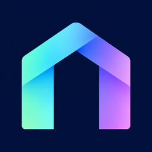
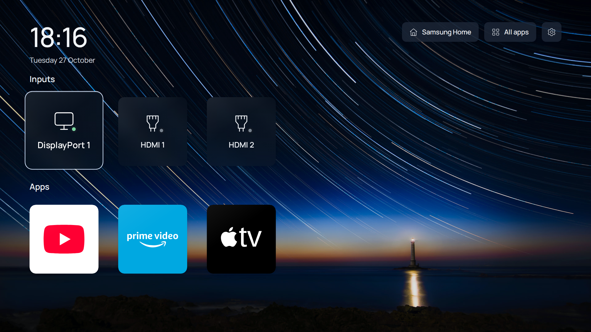
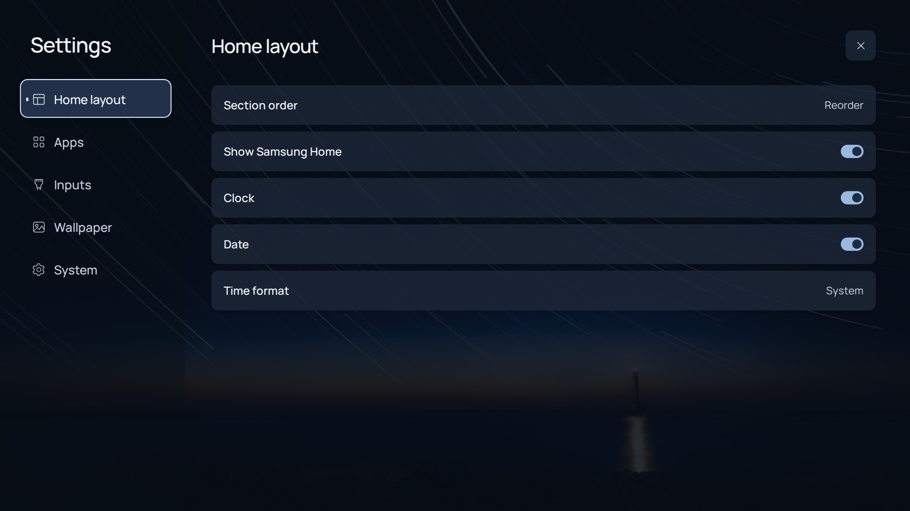
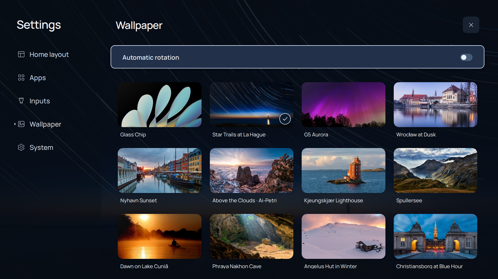

<div align="center">
  
  <h1>Prism</h1>
  <p><strong>Your inputs. Your apps. Your home screen.</strong></p>
  <p>A minimal launcher for Samsung Tizen monitors.</p>
  <p><a href="#installation">Install</a> · <a href="#features">Features</a> · <a href="VERIFIED_DEVICES.md">Tested devices</a> · <a href="#local-development">Development</a> · <a href="LICENSE">MIT license</a></p>
</div>



## Why Prism

A monitor should put your computer, console, and favourite apps within easy reach. Prism gives Samsung Tizen monitors a simple fullscreen home screen built around those everyday actions, controlled with the remote you already have.

On supported monitors, Prism opens when you power on and when you press Home. Check [tested devices](VERIFIED_DEVICES.md) for your model and firmware before installing.

## Features

- **Inputs and apps together.** Open installed apps or switch to your connected computer or console. Inputs appear first by default; you can change the order.
- **Make Home yours.** Reorder and hide tiles, rename input labels, and choose the order of the Apps and Inputs sections. All Apps keeps other launchable apps accessible.
- **Made for the remote.** Clear focus, directional navigation, and a hold-OK context menu. Keyboard and mouse controls also work in the browser preview.
- **App icons.** Uses artwork from the apps installed on your monitor.
- **Offline backgrounds.** Fifty curated wallpapers across landscapes, cities, aurora, and abstract artwork, with preview, rotation, and support for personal images when building.
- **Local preferences.** Your layout, wallpapers, clock and date settings are saved on the monitor. No Prism account or computer connection is needed after setup.
- **Samsung Home within reach.** Return to Samsung Home using the shortcut, which you can show or hide. Setup does not require root.

| Settings | Wallpapers |
| --- | --- |
|  |  |

Screenshots show the browser preview. Hiding a tile changes Prism's layout; it does not uninstall an app or disable Samsung services.

## Installation

You need a Samsung Tizen monitor, its remote, and a computer on the same local network. You'll also need internet access and your own Samsung account to sign the app during setup. Prism does not run on Android TV, webOS or Roku.

### Downloads

Prebuilt installers are not available yet. Use [source installation](#build-and-install-from-source) for now.

The [downloads page](https://github.com/shriram-ethiraj/prism/releases) will provide installers for Linux x64, macOS Intel/Apple Silicon and Windows x64. These include Prism and its setup tools, so you won't need to install developer tools separately. See the [installer guide](docs/setup.md#standalone-installation) for details.

### Install with an AI agent

If you use a local coding agent such as opencode, Codex or Claude Code, you can ask it to help with setup. Copy this prompt:

```text
Install Prism from https://github.com/shriram-ethiraj/prism on my Samsung Tizen monitor.
Follow AGENTS.md and docs/setup.md, and check my exact model and firmware against
VERIFIED_DEVICES.md. Use the repository's installer and preserve my existing settings
and recovery options. Guide me through Developer Mode and Samsung sign-in, keeping
credentials private. Help me check apps, inputs, physical Home and power-on behavior,
and tell me if anything is unsupported or still needs testing.
```

The agent needs to run on your computer. You still complete Samsung sign-in yourself and use the remote to check that everything works.

### Build and install from source

Install Git, Node.js 22.12+ with npm, Python 3.10+ and the .NET 8 SDK, then run:

```sh
git clone https://github.com/shriram-ethiraj/prism.git
cd prism
python install.py
```

Use `python3` if your computer doesn't have a `python` command. The installer prepares the app and walks you through connecting to the monitor, Samsung sign-in and installation.

You'll need the monitor's full model and firmware from **Settings → Support → About**, plus its local IP address. Enable Developer Mode with your computer's LAN IP; the [setup guide](docs/setup.md) explains where to find these and how to enter them.

After installation, check app launching, input switching, the Home button, standby and a full power-off/restart. Keep the original launcher and signing certificate so you can recover or update later. See [setup and recovery](docs/setup.md) for the full instructions.

### Compatibility

Tested on the **Samsung Odyssey G70B (LS28BG702EWXXL)** with firmware **T-PTMLWWC-1720.7**. Check [tested devices](VERIFIED_DEVICES.md) for results by Prism build. Other models and firmware aren't verified yet.

Tried another monitor? [Share a device report](https://github.com/shriram-ethiraj/prism/issues/new?template=device-report.yml)—partial success and failures are useful too.

## Remote controls

| Control | Action |
| --- | --- |
| Direction pad | Move focus between tiles and controls |
| OK / Enter | Open or select |
| Hold OK | Open a tile's Move/Hide menu; inputs also offer Edit label |
| Left / Right in Move | Reorder a tile |
| OK / Back in Move | Save / cancel |
| Back / Escape | Close the current popup, cancel a move, or return to Home from Settings and All Apps |
| Settings → Home layout | Reorder sections, show/hide Samsung Home, and configure clock/date |
| Settings → System | Open Samsung Home, refresh, credits, or reset Prism preferences |

Wallpaper rotation resumes when you return Home. Hidden tiles can be shown again in Settings. In the desktop preview, right-click or Shift+F10 opens a tile's menu.

## Local development

```sh
npm ci
npm run assets
npm run dev
```

Open [localhost:8765](http://127.0.0.1:8765). The preview uses example apps and inputs; it cannot control your monitor.

Run `npm run build` to create the app packages. To add personal wallpapers before building, see [custom wallpapers](assets/wallpapers/custom/README.md). Development checks and contribution guidelines are in [CONTRIBUTING.md](CONTRIBUTING.md).

## Troubleshooting and recovery

Start with [setup diagnostics and recovery](docs/setup.md). Certificate mismatch, connection rejection, fullscreen fit, and incomplete Home/startup checks each have separate remedies. Preserve your original author certificate for updates. Restore native routing before uninstalling any app assigned as Home.

## Contributing

Bug reports, device testing, and pull requests are welcome. Read [CONTRIBUTING.md](CONTRIBUTING.md) for checks and the device-report process. Share exact model/firmware and observed behavior, with private information removed. See [tested devices](VERIFIED_DEVICES.md) for exact per-build physical evidence and compatibility limitations.

## License and credits

Prism's original code is [MIT licensed](LICENSE). Bundled fonts, photography, brand artwork, and reused setup primitives retain their own attribution and terms in [THIRD_PARTY_NOTICES.md](THIRD_PARTY_NOTICES.md). Prism is an independent project and is not affiliated with Samsung.
